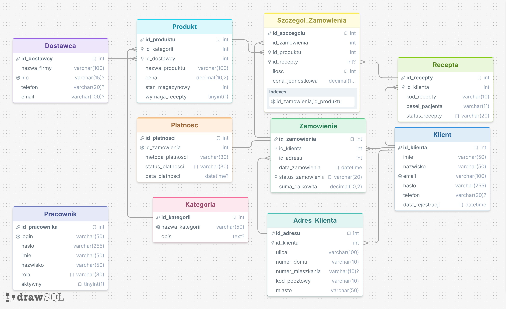

# RAPORT: PROJEKT RELACYJNEJ BAZY DANYCH DLA SYSTEMU APTEKI

**Skład zespołu projektowego:**
* Karol Walczyszyn (Kierownik projektu / Architekt bazy danych)
* Kacper Uchyła (Programista SQL)
* Łukasz Ziembiński (Backend Developer)
* Aleksandra Sandomierska (Frontend Developer)

**Temat projektu:** System Obsługi Apteki (nr. 11)  
**Środowisko bazodanowe:** MariaDB / MySQL (silnik `InnoDB`, kodowanie `utf8mb4`, kolacja `utf8mb4_unicode_ci`)

---

## I. Podsumowanie wykonanych prac związanych z architekturą tabel

W ramach aktualizacji projektu wdrożono przejrzysty, znormalizowany model relacyjnej bazy danych składający się z **10 wyspecjalizowanych encji** (nazewnictwo w liczbie pojedynczej zgodnie ze standardem akademickim), zaimplementowanych fizycznie w skrypcie `DBInit.sql` i odwzorowanych na diagramie ERD (`drawSQL`).

W stosunku do wcześniejszych iteracji przebudowano logikę systemu w następujących obszarach:

1. **Rozdzielenie domen użytkowników (`Klient`, `Pracownik`):** Zrezygnowano ze wspólnej tabeli użytkowników na rzecz ścisłej separacji klientów apteki (rejestracja po unikalnym adresie `email`) oraz personelu obsługującego system (autoryzacja po unikalnym polu `login` z podziałem na role `FARMACEUTA`, `KIEROWNIK`, `ADMIN` oraz flagą aktywności `aktywny`). Obsługę tokenów sesyjnych przeniesiono do warstwy aplikacyjnej.
2. **Konsolidacja katalogu produktów i łańcucha dostaw (`Produkt`, `Kategoria`, `Dostawca`):** Stan magazynowy skonsolidowano bezpośrednio na poziomie encji `Produkt` (`stan_magazynowy` z zabezpieczeniem `CHECK (stan_magazynowy >= 0)`), łącząc każdy preparat z dedykowanym słownikiem kategorii (`Kategoria`) oraz rejestrem hurtowni i dystrybutorów (`Dostawca` z unikalnym numerem `nip`).
3. **Znormalizowana książka adresowa klienta (`Adres_Klienta`):** Wydzielono wieloadresową książkę adresową przypisaną do konta klienta w relacji $1:N$, eliminując powielanie danych adresowych w profilach i zamówieniach.
4. **Kompleksowa obsługa zamówień, e-recept i płatności (`Zamowienie`, `Szczegol_Zamowienia`, `Recepta`, `Platnosc`):**
   * Wprowadzono mechanizm utrwalania ceny zakupu (`cena_jednostkowa` w `Szczegol_Zamowienia`), chroniący historię transakcji przed późniejszymi zmianami w cenniku katalogowym.
   * Powiązano e-recepty z kontem klienta oraz pozycjami zamówienia, weryfikując je za pomocą 10-znakowego `kod_recepty`, 11-znakowego `pesel_pacjenta` oraz 4-stanowego cyklu życia (`NOWA`, `ZWERYFIKOWANA`, `ZREALIZOWANA`, `ODRZUCONA`).
   * Wydzielono rozliczenia finansowe do osobnej encji `Platnosc` połączonej ścisłą relacją $1:1$ z zamówieniem (`id_zamowienia INT NOT NULL UNIQUE`).
5. **Rygorystyczne więzy spójności i indeksowanie:** Wdrożono zróżnicowane reguły integralności referencyjnej (`ON DELETE RESTRICT`, `ON DELETE CASCADE`, `ON DELETE SET NULL`), ograniczenia dziedzinowe `CHECK`, unikalny indeks złożony `uq_zamowienie_produkt (id_zamowienia, id_produktu)` oraz 8 indeksów przyspieszających złączenia i filtrowanie.

---

## II. Opis zadania i reguł biznesowych

Baza danych wspiera kluczowe procesy biznesowe apteki internetowej i stacjonarnej: rejestrację pacjentów, zarządzanie personelem i uprawnieniami, obsługę katalogu leków (zarówno bez recepty — OTC, jak i wydawanych z przepisu lekarza — Rx), weryfikację e-recept, realizację zamówień na wskazane adresy oraz ewidencję płatności.

### 1. Użytkownicy systemu (`Klient`, `Pracownik`)
* **Klienci (`Klient`):** Osoby składające zamówienia w aptece. Każdy klient identyfikowany jest unikalnym adresem `email`, posiada zahaszowane hasło (`haslo`), imię, nazwisko, opcjonalny telefon oraz automatycznie rejestrowaną datę utworzenia konta (`data_rejestracji`).
* **Personel (`Pracownik`):** Pracownicy apteki logujący się za pomocą unikalnego identyfikatora `login` oraz hasła. Zakres uprawnień w systemie określa pole `rola` (domyślnie `'FARMACEUTA'`, dopuszczalne także `'KIEROWNIK'` i `'ADMIN'`), a pole `aktywny` umożliwia natychmiastową blokadę konta bez usuwania historii pracy.

### 2. Katalog produktów i zaopatrzenie (`Produkt`, `Kategoria`, `Dostawca`)
* **Kategorie (`Kategoria`):** Słownik grup terapeutycznych i asortymentowych (np. leki przeciwbólowe, antybiotyki, suplementy diety) o unikalnych nazwach.
* **Dostawcy (`Dostawca`):** Rejestr hurtowni farmaceutycznych i producentów zaopatrujących aptekę, identyfikowany nazwą firmy oraz opcjonalnym, unikalnym numerem `nip`.
* **Produkty (`Produkt`):** Centralny katalog preparatów zawierający cenę detaliczną (`cena`), aktualną liczbę dostępnych opakowań (`stan_magazynowy`) oraz flagę `wymaga_recepty` ($1$ = lek na receptę Rx, $0$ = lek dostępny bez recepty OTC).

### 3. Obsługa adresów i zamówień (`Adres_Klienta`, `Zamowienie`, `Szczegol_Zamowienia`)
* Klient może zapisać w tabeli `Adres_Klienta` wiele lokalizacji doręczenia (np. adres domowy, adres miejsca pracy), podając ulicę, numer domu, opcjonalny numer mieszkania, kod pocztowy i miasto.
* Złożenie zamówienia tworzy nagłówek w tabeli `Zamowienie`, wiążąc klienta (`id_klienta`) oraz konkretny wybrany adres dostawy (`id_adresu`), rejestrując czas złożenia (`data_zamowienia`), kwotę całkowitą (`suma_calkowita`) oraz aktualny etap realizacji (`status_zamowienia` z domyślną wartością `'NOWE'`).
* Pozycje zamówienia trafiają do tabeli `Szczegol_Zamowienia`, gdzie zapisywana jest zamówiona liczba opakowań (`ilosc` $> 0$) oraz historyczna cena jednostkowa (`cena_jednostkowa` $\ge 0$). Unikalny klucz złożony `(id_zamowienia, id_produktu)` gwarantuje, że ten sam preparat nie zostanie zdublowany jako osobny wiersz w ramach jednego zamówienia.

### 4. Weryfikacja e-recept i rozliczenia finansowe (`Recepta`, `Platnosc`)
* **Recepty (`Recepta`):** Jeśli zamówiony produkt wymaga recepty (`Produkt.wymaga_recepty = 1`), pozycja w `Szczegol_Zamowienia` musi zostać powiązana poprzez `id_recepty` z rekordem w tabeli `Recepta`. Recepta należy do konkretnego klienta (`id_klienta`) i przechowuje `kod_recepty`, `pesel_pacjenta` oraz status weryfikacji (`NOWA`, `ZWERYFIKOWANA`, `ZREALIZOWANA`, `ODRZUCONA`).
* **Płatności (`Platnosc`):** Każde zamówienie posiada dokładnie jedną powiązaną płatność (relacja $1:1$), rejestrującą wybraną metodę zapłaty (`metoda_platnosci`), bieżący status rozliczenia (`OCZEKUJACA`, `OPLACONA`, `NIEUDANA`, `ZWROCONA`) oraz znacznik czasu zaksięgowania wpłaty (`data_platnosci`).

---

## III. Diagram Związków Encji (ERD)

Schemat bazy danych obejmuje **10 powiązanych tabel** pogrupowanych w trzy główne podsystemy funkcjonalne:

1. **Podsystem Asortymentu i Zaopatrzenia:** `Kategoria`, `Dostawca`, `Produkt`.
2. **Podsystem Klienta, Adresów i Recept:** `Klient`, `Adres_Klienta`, `Recepta`.
3. **Podsystem Zamówień, Rozliczeń i Personelu:** `Zamowienie`, `Szczegol_Zamowienia`, `Platnosc`, `Pracownik`.

---

## IV. Słownik Danych ERD

### 1. Tabela: `Kategoria`
**Rola w systemie:** Tabela słownikowa klasyfikująca produkty farmaceutyczne i wyroby medyczne według grup terapeutycznych lub asortymentowych.

| Element danych (Kolumna) | Typ danych    | Warunki i ograniczenia                       | Opis                                      |
| :----------------------- | :------------ | :------------------------------------------- | :---------------------------------------- |
| `id_kategorii`           | `INT`         | OBOWIĄZKOWY, Klucz główny (`AUTO_INCREMENT`) | Unikalny identyfikator kategorii.         |
| `nazwa_kategorii`        | `VARCHAR(50)` | OBOWIĄZKOWY, Unikalny (`UNIQUE`)             | Unikalna nazwa kategorii produktów.       |
| `opis`                   | `TEXT`        | OPCJONALNY (`NULL`)                          | Szczegółowy opis przeznaczenia kategorii. |

### 2. Tabela: `Dostawca`
**Rola w systemie:** Ewidencja hurtowni farmaceutycznych i dystrybutorów zaopatrujących aptekę w leki i suplementy.

| Element danych (Kolumna) | Typ danych     | Warunki i ograniczenia                       | Opis                                              |
| :----------------------- | :------------- | :------------------------------------------- | :------------------------------------------------ |
| `id_dostawcy`            | `INT`          | OBOWIĄZKOWY, Klucz główny (`AUTO_INCREMENT`) | Unikalny identyfikator dostawcy.                  |
| `nazwa_firmy`            | `VARCHAR(100)` | OBOWIĄZKOWY                                  | Pełna nazwa podmiotu dostarczającego.             |
| `nip`                    | `VARCHAR(15)`  | OPCJONALNY (`NULL`), Unikalny (`UNIQUE`)     | Numer Identyfikacji Podatkowej hurtowni/dostawcy. |
| `telefon`                | `VARCHAR(20)`  | OPCJONALNY (`NULL`)                          | Numer telefonu kontaktowego do dostawcy.          |
| `email`                  | `VARCHAR(100)` | OPCJONALNY (`NULL`)                          | Adres e-mail do obsługi zamówień hurtowych.       |

### 3. Tabela: `Pracownik`
**Rola w systemie:** Ewidencja personelu apteki posiadającego uprawnienia do obsługi systemu, weryfikacji recept i zarządzania stanami magazynowymi.

| Element danych (Kolumna) | Typ danych     | Warunki i ograniczenia                                                                      | Opis                                                       |
| :----------------------- | :------------- | :------------------------------------------------------------------------------------------ | :--------------------------------------------------------- |
| `id_pracownika`          | `INT`          | OBOWIĄZKOWY, Klucz główny (`AUTO_INCREMENT`)                                                | Unikalny identyfikator pracownika.                         |
| `login`                  | `VARCHAR(50)`  | OBOWIĄZKOWY, Unikalny (`UNIQUE`)                                                            | Unikalny login używany do uwierzytelniania.                |
| `haslo`                  | `VARCHAR(255)` | OBOWIĄZKOWY                                                                                 | Kryptograficzny skrót (hash) hasła pracownika.             |
| `imie`                   | `VARCHAR(50)`  | OBOWIĄZKOWY                                                                                 | Imię pracownika.                                           |
| `nazwisko`               | `VARCHAR(50)`  | OBOWIĄZKOWY                                                                                 | Nazwisko pracownika.                                       |
| `rola`                   | `VARCHAR(30)`  | OBOWIĄZKOWY, `DEFAULT 'FARMACEUTA'`, `CHECK (rola IN ('FARMACEUTA', 'KIEROWNIK', 'ADMIN'))` | Rola warunkująca poziom uprawnień w systemie.              |
| `aktywny`                | `TINYINT(1)`   | OBOWIĄZKOWY, `DEFAULT 1`                                                                    | Flaga aktywności konta ($1$ = aktywne, $0$ = zablokowane). |

### 4. Tabela: `Klient`
**Rola w systemie:** Centralna encja przechowująca dane kont zarejestrowanych pacjentów i kupujących.

| Element danych (Kolumna) | Typ danych     | Warunki i ograniczenia                       | Opis                                                   |
| :----------------------- | :------------- | :------------------------------------------- | :----------------------------------------------------- |
| `id_klienta`             | `INT`          | OBOWIĄZKOWY, Klucz główny (`AUTO_INCREMENT`) | Unikalny identyfikator klienta.                        |
| `imie`                   | `VARCHAR(50)`  | OBOWIĄZKOWY                                  | Imię klienta.                                          |
| `nazwisko`               | `VARCHAR(50)`  | OBOWIĄZKOWY                                  | Nazwisko klienta.                                      |
| `email`                  | `VARCHAR(100)` | OBOWIĄZKOWY, Unikalny (`UNIQUE`)             | Unikalny adres e-mail pełniący funkcję loginu klienta. |
| `haslo`                  | `VARCHAR(255)` | OBOWIĄZKOWY                                  | Kryptograficzny skrót (hash) hasła dostępowego.        |
| `telefon`                | `VARCHAR(20)`  | OPCJONALNY (`NULL`)                          | Numer telefonu kontaktowego do powiadomień.            |
| `data_rejestracji`       | `DATETIME`     | OBOWIĄZKOWY, `DEFAULT CURRENT_TIMESTAMP`     | Data i czas rejestracji konta w systemie.              |

### 5. Tabela: `Adres_Klienta`
**Rola w systemie:** Znormalizowana książka adresowa pozwalająca klientowi na zapisanie wielu lokalizacji doręczenia zamówień.

| Element danych (Kolumna) | Typ danych     | Warunki i ograniczenia                                                                           | Opis                                       |
| :----------------------- | :------------- | :----------------------------------------------------------------------------------------------- | :----------------------------------------- |
| `id_adresu`              | `INT`          | OBOWIĄZKOWY, Klucz główny (`AUTO_INCREMENT`)                                                     | Unikalny identyfikator zapisanego adresu.  |
| `id_klienta`             | `INT`          | OBOWIĄZKOWY, Klucz obcy (`-> Klient.id_klienta`, `ON DELETE CASCADE`), Indeks `idx_adres_klient` | Właściciel wpisu adresowego.               |
| `ulica`                  | `VARCHAR(100)` | OBOWIĄZKOWY                                                                                      | Nazwa ulicy.                               |
| `numer_domu`             | `VARCHAR(10)`  | OBOWIĄZKOWY                                                                                      | Numer budynku.                             |
| `numer_mieszkania`       | `VARCHAR(10)`  | OPCJONALNY (`NULL`)                                                                              | Numer lokalu / mieszkania (jeśli dotyczy). |
| `kod_pocztowy`           | `VARCHAR(10)`  | OBOWIĄZKOWY                                                                                      | Kod pocztowy miejscowości.                 |
| `miasto`                 | `VARCHAR(50)`  | OBOWIĄZKOWY                                                                                      | Nazwa miejscowości doręczenia.             |

### 6. Tabela: `Produkt`
**Rola w systemie:** Główny katalog leków i suplementów oferowanych przez aptekę wraz z ceną, stanem magazynowym i flagą wymogu recepty.

| Element danych (Kolumna) | Typ danych       | Warunki i ograniczenia                                                                                      | Opis                                                    |
| :----------------------- | :--------------- | :---------------------------------------------------------------------------------------------------------- | :------------------------------------------------------ |
| `id_produktu`            | `INT`            | OBOWIĄZKOWY, Klucz główny (`AUTO_INCREMENT`)                                                                | Unikalny identyfikator produktu leczniczego.            |
| `id_kategorii`           | `INT`            | OBOWIĄZKOWY, Klucz obcy (`-> Kategoria.id_kategorii`, `ON DELETE RESTRICT`), Indeks `idx_produkt_kategoria` | Kategoria asortymentowa produktu.                       |
| `id_dostawcy`            | `INT`            | OBOWIĄZKOWY, Klucz obcy (`-> Dostawca.id_dostawcy`, `ON DELETE RESTRICT`), Indeks `idx_produkt_dostawca`    | Główny dostawca / hurtownia produktu.                   |
| `nazwa_produktu`         | `VARCHAR(100)`   | OBOWIĄZKOWY                                                                                                 | Handlowa nazwa leku lub suplementu.                     |
| `cena`                   | `DECIMAL(10, 2)` | OBOWIĄZKOWY, `CHECK (cena >= 0)`                                                                            | Bieżąca cena katalogowa brutto produktu.                |
| `stan_magazynowy`        | `INT`            | OBOWIĄZKOWY, `DEFAULT 0`, `CHECK (stan_magazynowy >= 0)`                                                    | Aktualna liczba opakowań dostępnych na stanie apteki.   |
| `wymaga_recepty`         | `TINYINT(1)`     | OBOWIĄZKOWY, `DEFAULT 0`                                                                                    | Wymóg recepty ($1$ = lek na receptę Rx, $0$ = lek OTC). |

### 7. Tabela: `Recepta`
**Rola w systemie:** Ewidencja recept lekarskich powiązanych z klientami, wykorzystywana do weryfikacji uprawnień zakupu leków Rx.

| Element danych (Kolumna) | Typ danych    | Warunki i ograniczenia                                                                                            | Opis                                                   |
| :----------------------- | :------------ | :---------------------------------------------------------------------------------------------------------------- | :----------------------------------------------------- |
| `id_recepty`             | `INT`         | OBOWIĄZKOWY, Klucz główny (`AUTO_INCREMENT`)                                                                      | Wewnętrzny identyfikator recepty.                      |
| `id_klienta`             | `INT`         | OBOWIĄZKOWY, Klucz obcy (`-> Klient.id_klienta`, `ON DELETE CASCADE`), Indeks `idx_recepta_klient`                | Pacjent / właściciel recepty.                          |
| `kod_recepty`            | `VARCHAR(10)` | OBOWIĄZKOWY                                                                                                       | Kod dostępu e-recepty lub identyfikator recepty.       |
| `pesel_pacjenta`         | `VARCHAR(11)` | OBOWIĄZKOWY                                                                                                       | Numer PESEL pacjenta weryfikujący prawo do realizacji. |
| `status_recepty`         | `VARCHAR(20)` | OBOWIĄZKOWY, `DEFAULT 'NOWA'`, `CHECK (status_recepty IN ('NOWA', 'ZWERYFIKOWANA', 'ZREALIZOWANA', 'ODRZUCONA'))` | Status weryfikacji i realizacji recepty.               |

### 8. Tabela: `Zamowienie`
**Rola w systemie:** Nagłówek transakcji zakupu rejestrujący klienta, wybrany adres dostawy, datę złożenia, status realizacji oraz wartość całkowitą.

| Element danych (Kolumna) | Typ danych       | Warunki i ograniczenia                                                                                                                                                     | Opis                                               |
| :----------------------- | :--------------- | :------------------------------------------------------------------------------------------------------------------------------------------------------------------------- | :------------------------------------------------- |
| `id_zamowienia`          | `INT`            | OBOWIĄZKOWY, Klucz główny (`AUTO_INCREMENT`)                                                                                                                               | Unikalny numer zamówienia.                         |
| `id_klienta`             | `INT`            | OBOWIĄZKOWY, Klucz obcy (`-> Klient.id_klienta`, `ON DELETE RESTRICT`), Indeks `idx_zamowienie_klient`                                                                     | Klient składający zamówienie.                      |
| `id_adresu`              | `INT`            | OBOWIĄZKOWY, Klucz obcy (`-> Adres_Klienta.id_adresu`, `ON DELETE RESTRICT`)                                                                                               | Wybrany adres dostawy z książki adresowej klienta. |
| `data_zamowienia`        | `DATETIME`       | OBOWIĄZKOWY, `DEFAULT CURRENT_TIMESTAMP`                                                                                                                                   | Data i godzina złożenia zamówienia.                |
| `status_zamowienia`      | `VARCHAR(20)`    | OBOWIĄZKOWY, `DEFAULT 'NOWE'`, `CHECK (status_zamowienia IN ('NOWE', 'OPLACONE', 'W_REALIZACJI', 'WYSLANE', 'ZREALIZOWANE', 'ANULOWANE'))`, Indeks `idx_zamowienie_status` | Aktualny etap obsługi zamówienia w aptece.         |
| `suma_calkowita`         | `DECIMAL(10, 2)` | OBOWIĄZKOWY, `DEFAULT 0.00`, `CHECK (suma_calkowita >= 0)`                                                                                                                 | Łączna kwota brutto do zapłaty za zamówienie.      |

### 9. Tabela: `Szczegol_Zamowienia`
**Rola w systemie:** Tabela pozycji zamówienia realizująca relację wiele-do-wielu ($N:M$) między zamówieniem a produktami, z utrwaleniem ceny zakupu i opcjonalnym powiązaniem z receptą.

| Element danych (Kolumna) | Typ danych       | Warunki i ograniczenia                                                                                         | Opis                                                                      |
| :----------------------- | :--------------- | :------------------------------------------------------------------------------------------------------------- | :------------------------------------------------------------------------ |
| `id_szczegolu`           | `INT`            | OBOWIĄZKOWY, Klucz główny (`AUTO_INCREMENT`)                                                                   | Unikalny identyfikator pozycji zamówienia.                                |
| `id_zamowienia`          | `INT`            | OBOWIĄZKOWY, Klucz obcy (`-> Zamowienie.id_zamowienia`, `ON DELETE CASCADE`)                                   | Identyfikator zamówienia nadrzędnego.                                     |
| `id_produktu`            | `INT`            | OBOWIĄZKOWY, Klucz obcy (`-> Produkt.id_produktu`, `ON DELETE RESTRICT`), Indeks `idx_szczegol_produkt`        | Identyfikator zamawianego produktu.                                       |
| `id_recepty`             | `INT`            | OPCJONALNY (`NULL`), Klucz obcy (`-> Recepta.id_recepty`, `ON DELETE SET NULL`), Indeks `idx_szczegol_recepta` | Przypisana recepta (wymagana przy produktach Rx, `NULL` dla OTC).         |
| `ilosc`                  | `INT`            | OBOWIĄZKOWY, `DEFAULT 1`, `CHECK (ilosc > 0)`                                                                  | Liczba zamówionych opakowań produktu.                                     |
| `cena_jednostkowa`       | `DECIMAL(10, 2)` | OBOWIĄZKOWY, `CHECK (cena_jednostkowa >= 0)`                                                                   | Utrwalona historyczna cena jednostkowa z chwili zakupu.                   |
| **Ograniczenie złożone** | —                | `CONSTRAINT uq_zamowienie_produkt UNIQUE (id_zamowienia, id_produktu)`                                         | Blokada duplikatów: dany produkt występuje w jednym zamówieniu tylko raz. |

### 10. Tabela: `Platnosc`
**Rola w systemie:** Ewidencja rozliczeń finansowych powiązanych w relacji $1:1$ z zamówieniami.

| Element danych (Kolumna) | Typ danych    | Warunki i ograniczenia                                                                                                | Opis                                                        |
| :----------------------- | :------------ | :-------------------------------------------------------------------------------------------------------------------- | :---------------------------------------------------------- |
| `id_platnosci`           | `INT`         | OBOWIĄZKOWY, Klucz główny (`AUTO_INCREMENT`)                                                                          | Unikalny identyfikator transakcji płatniczej.               |
| `id_zamowienia`          | `INT`         | OBOWIĄZKOWY, Unikalny (`UNIQUE`), Klucz obcy (`-> Zamowienie.id_zamowienia`, `ON DELETE CASCADE`)                     | Opłacane zamówienie (unikalność wymusza relację $1:1$).     |
| `metoda_platnosci`       | `VARCHAR(30)` | OBOWIĄZKOWY                                                                                                           | Wybrana forma płatności (np. `BLIK`, `KARTA`, `PRZELEW`).   |
| `status_platnosci`       | `VARCHAR(30)` | OBOWIĄZKOWY, `DEFAULT 'OCZEKUJACA'`, `CHECK (status_platnosci IN ('OCZEKUJACA', 'OPLACONA', 'NIEUDANA', 'ZWROCONA'))` | Status rozliczenia transakcji.                              |
| `data_platnosci`         | `DATETIME`    | OPCJONALNY (`NULL`)                                                                                                   | Data i czas potwierdzenia wpłaty (`NULL` przed opłaceniem). |

---

## V. Relacje między encjami

W architekturze bazy danych zastosowano spójny zestaw kluczy obcych i reguł usuwania (`ON DELETE`), chroniących integralność historyczną i finansową apteki:

1. **`Kategoria`** $\rightarrow$ **`Produkt` (Relacja** $1:N$**):**
   * Jedna kategoria obejmuje wiele produktów, a każdy produkt należy do jednej kategorii (`Produkt.id_kategorii`). Reguła `ON DELETE RESTRICT` uniemożliwia usunięcie kategorii, do której przypisane są produkty.
2. **`Dostawca`** $\rightarrow$ **`Produkt` (Relacja** $1:N$**):**
   * Jeden dostawca dostarcza wiele produktów (`Produkt.id_dostawcy`). Reguła `ON DELETE RESTRICT` chroni katalog przed osieroceniem produktów przez usunięcie hurtowni.
3. **`Klient`** $\rightarrow$ **`Adres_Klienta` (Relacja** $1:N$**):**
   * Jeden klient może zapisać wiele adresów doręczenia (`Adres_Klienta.id_klienta`). Usunięcie konta klienta bez zamówień kaskadowo usuwa jego adresy (`ON DELETE CASCADE`).
4. **`Klient`** $\rightarrow$ **`Recepta` (Relacja** $1:N$**):**
   * Jeden klient może posiadać wiele recept w systemie (`Recepta.id_klienta`, reguła `ON DELETE CASCADE`).
5. **`Klient`** $\rightarrow$ **`Zamowienie` (Relacja** $1:N$**):**
   * Jeden klient może złożyć wiele zamówień (`Zamowienie.id_klienta`). Reguła `ON DELETE RESTRICT` uniemożliwia skasowanie konta klienta, który posiada historię zamówień w aptece.
6. **`Adres_Klienta`** $\rightarrow$ **`Zamowienie` (Relacja** $1:N$**):**
   * Zapisany adres z książki adresowej może być wykorzystywany w wielu zamówieniach (`Zamowienie.id_adresu`). Reguła `ON DELETE RESTRICT` blokuje usunięcie adresu użytego w złożonym już zamówieniu, zabezpieczając dokumentację wysyłkową.
7. **`Zamowienie`** $\leftrightarrow$ **`Produkt` (Relacja** $N:M$ **poprzez `Szczegol_Zamowienia`):**
   * Jedno zamówienie obejmuje wiele produktów, a dany produkt może znajdować się w wielu zamówieniach. Usunięcie zamówienia kaskadowo usuwa jego pozycje (`ON DELETE CASCADE`), natomiast usunięcie produktu z katalogu jest zablokowane, jeśli widnieje on w jakimkolwiek zamówieniu (`ON DELETE RESTRICT`).
8. **`Recepta`** $\rightarrow$ **`Szczegol_Zamowienia` (Relacja** $1:N$ **opcjonalna):**
   * Jedna recepta może pokrywać kilka pozycji w ramach zamówienia (`Szczegol_Zamowienia.id_recepty`). Dla produktów OTC pole przyjmuje wartość `NULL`, a w przypadku usunięcia recepty referencja jest bezpiecznie zerowana bez usuwania pozycji zamówienia (`ON DELETE SET NULL`).
9. **`Zamowienie`** $\leftrightarrow$ **`Platnosc` (Relacja** $1:1$**):**
   * Każde zamówienie posiada dokładnie jeden rekord rozliczenia finansowego (`Platnosc.id_zamowienia` z ograniczeniem `UNIQUE`). Usunięcie zamówienia kaskadowo usuwa powiązaną płatność (`ON DELETE CASCADE`).

---

## VI. Normalizacja Bazy Danych

Projekt bazy danych spełnia wszystkie kryteria **trzeciej postaci normalnej (3NF)**:

1. **Pierwsza Postać Normalna (1NF):**
   * Wszystkie atrybuty we wszystkich 10 tabelach przechowują wyłącznie wartości atomowe (niepodzielne).
   * Dane adresowe w tabeli `Adres_Klienta` rozbito na odrębne kolumny (`ulica`, `numer_domu`, `numer_mieszkania`, `kod_pocztowy`, `miasto`), a dane osobowe w tabelach `Klient` i `Pracownik` rozdzielono na `imie` oraz `nazwisko`. W żadnej tabeli nie występują powtarzające się grupy kolumn ani listy wartości w jednym polu.
2. **Druga Postać Normalna (2NF):**
   * Baza spełnia warunki 1NF, a każda tabela posiada jednoznaczny klucz główny (`PK`), od którego w pełni funkcyjnie zależą wszystkie atrybuty niekluczowe.
   * W tabeli asocjacyjnej `Szczegol_Zamowienia` (z identyfikatorem `id_szczegolu` oraz unikalnym ograniczeniem na parze `(id_zamowienia, id_produktu)`) wartości `ilosc`, `cena_jednostkowa` oraz opcjonalny klucz `id_recepty` zależą ściśle od konkretnego powiązania zamówienia z produktem, a nie od samego produktu czy samego zamówienia osobno.
3. **Trzecia Postać Normalna (3NF):**
   * Wyeliminowano zależności przechodnie pomiędzy atrybutami niekluczowymi — każda kolumna niekluczowa zależy bezpośrednio wyłącznie od klucza głównego swojej tabeli:
     * Dane dostawców (`nazwa_firmy`, `nip`, `telefon`, `email`) oraz opisy kategorii wydzielono do osobnych słowników `Dostawca` i `Kategoria`, zapobiegając redundancji danych w tabeli `Produkt`.
     * Adresy dostawy wydzielono do encji `Adres_Klienta`, dzięki czemu tabela `Zamowienie` przechowuje wyłącznie klucz obcy `id_adresu` bez powielania nazwy ulicy, kodu pocztowego czy miasta przy każdym kolejnym zakupie.
     * Szczegóły transakcji finansowej (`metoda_platnosci`, `status_platnosci`, `data_platnosci`) odseparowano do encji `Platnosc`, oddzielając cykl życia płatności od cyklu realizacji samego zamówienia.