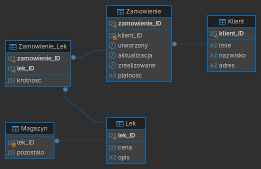

# Plan Działania i Specyfikacja Wymagań Projektu

**Przedmiot:** Projektowanie i tworzenie relacyjnej bazy danych
**Prowadzący:** prof. Olena Stankevych | **Wybrana dziedzina:** nr 11 -- Apteka
**Skład zespołu:** [Osoba 1], [Osoba 2], [Osoba 3], [Osoba 4 (opcjonalnie)]

---

## 1. Cel projektu i założenia biznesowe
Celem projektu jest praktyczne zaprojektowanie, zaimplementowanie oraz zintegrowanie relacyjnej bazy danych wspierającej obsługę zamówień i gospodarkę magazynową apteki. Realizacja projektu obejmuje cztery filary wymagane w specyfikacji przedmiotu:
1. **Projektowanie koncepcyjne i logiczne:** opracowanie diagramu ERD, słownika danych oraz przeprowadzenie normalizacji struktur do trzeciej postaci normalnej (3NF).
2. **Fizyczna implementacja w SBD (DBMS):** utworzenie struktur tabel za pomocą skryptów DDL (z kluczami głównymi, obcymi i więzami integralności) oraz zasilenie bazy danymi początkowymi (Seed Data).
3. **Logika programistyczna SQL:** implementacja zaawansowanych zapytań analitycznych, procedur składowanych, wyzwalaczy (triggerów) oraz mechanizmu transakcji.
4. **Integracja z aplikacją:** podłączenie bazy danych do aplikacji zewnętrznej realizującej pełny zestaw operacji CRUD (tworzenie, odczyt, aktualizacja, usuwanie).

## 2. Zestawienie wymagań projektowych i produktów cząstkowych
Poniższa tabela syntetyzuje wszystkie wymagania formalne projektu wraz z zaplanowanym sposobem ich realizacji w ramach systemu dla apteki.

| Etap projektu        | Wymagane elementy do oddania                                                                                  | Zakres w projekcie „Apteka”                                                                               |
| :------------------- | :------------------------------------------------------------------------------------------------------------ | :-------------------------------------------------------------------------------------------------------- |
| **1. Dokumentacja**  | Diagram ERD (encje, atrybuty, PK, FK, relacje 1:1, 1:N, N:M), słownik danych, uzasadnienie 3NF.               | 5 powiązanych tabel obsługujących klientów, zamówienia, pozycje zamówień, katalog leków i magazyn.        |
| **2. Struktura SBD** | Skrypty DDL (`CREATE TABLE`, klucze, ograniczenia) oraz skrypty DML (`INSERT` min. 5--10 rekordów/tabela).    | Definicja ograniczeń `NOT NULL`, `UNIQUE`, `CHECK` (np. dodatnia cena i krotność) oraz dane testowe.      |
| **3. Logika SQL**    | Min. 4--5 złożonych zapytań (`JOIN`, `GROUP BY`, podzapytania), min. 1 procedura, min. 1 trigger, transakcje. | Plik `queries.sql`: raporty sprzedaży, procedura składania zamówienia, trigger aktualizacji daty i stanu. |
| **4. Aplikacja**     | Integracja bazy z interfejsem użytkownika (CRUD), archiwum kodu oraz prezentacja końcowa.                     | Panel obsługi apteki pozwalający na rejestrację klienta, złożenie zamówienia i podgląd magazynu.          |

## 3. Architektura bazy danych (Diagram ERD i Słownik Danych)
Model logiczny bazy danych został zaprojektowany zgodnie z zasadami trzeciej postaci normalnej (3NF): wszystkie atrybuty są atomowe (1NF), zależą w pełni od klucza głównego (2NF -- w tabeli asocjacyjnej `Zamowienie_Lek` atrybut `krotnosc` zależy od złożonego klucza głównego), a w tabelach nie występują zależności przechodnie między atrybutami niekluczowych (3NF -- dane klienta, opis leku oraz stan magazynowy są odseparowane od nagłówka zamówienia).

**Wstępny słownik danych (na podstawie opracowanego schematu ERD):**

| Tabela           | Kolumny i klucze                                                                                | Typy danych                            | Więzy integralności i opis roli                                                                           |
| :--------------- | :---------------------------------------------------------------------------------------------- | :------------------------------------- | :-------------------------------------------------------------------------------------------------------- |
| `Klient`         | `klient_ID` (PK), `imie`, `nazwisko`, `adres`                                                   | `INT`, `VARCHAR(50)`, `VARCHAR(150)`   | `PK AUTO_INCREMENT`, pola danych osobowych `NOT NULL`. Przechowuje dane pacjentów/klientów.               |
| `Zamowienie`     | `zamowienie_ID` (PK), `klient_ID` (FK), `utworzony`, `aktualizacja`, `zrealizowane`, `platnosc` | `INT`, `DATETIME`, `VARCHAR(30)`       | Relacja 1:N z tabelą `Klient`. Śledzi cykl życia zamówienia oraz formę/status płatności.                  |
| `Zamowienie_Lek` | `zamowienie_ID` (PK, FK), `lek_ID` (PK, FK), `krotnosc`                                         | `INT`                                  | Tabela łącząca (realizacja relacji N:M). Ograniczenie `CHECK (krotnosc > 0)`.                             |
| `Lek`            | `lek_ID` (PK), `cena`, `opis`                                                                   | `INT`, `DECIMAL(10,2)`, `VARCHAR(255)` | Katalog preparatów aptecznych. Wymagane ograniczenie `CHECK (cena > 0)` oraz `opis NOT NULL`.             |
| `Magazyn`        | `lek_ID` (PK/FK), `pozostalo`                                                                   | `INT`                                  | Stan magazynowy przypisany do leku. Ograniczenie `CHECK (pozostalo >= 0)` chroniące przed ujemnym stanem. |

## 4. Planowana logika programistyczna po stronie bazy danych (Etap 3)
W ramach pliku `queries.sql` zaplanowano wdrożenie następujących mechanizmów bazodanowych rozwiązujących realne problemy biznesowe apteki:
- **Zaawansowane zapytania analityczne (5 zapytań):**
  1. *Wyszukiwanie najlepszych klientów:* złączenie (`JOIN`) tabel `Klient`, `Zamowienie`, `Zamowienie_Lek` oraz `Lek` z grupowaniem (`GROUP BY`) i obliczeniem łącznej wartości zakupów.
  2. *Analiza bestsellerów aptecznych:* zestawienie najczęściej zamawianych leków wraz z ich udziałem w przychodzie (użycie funkcji agregujących `SUM`, `COUNT`, `AVG`).
  3. *Raport krytycznych stanów magazynowych:* zapytanie z podzapytaniem (`SUBQUERY`) identyfikujące leki, których stan w tabeli `Magazyn` (`pozostalo`) spadł poniżej średniej sprzedaży tygodniowej.
  4. *Zestawienie skuteczności płatności i czasu realizacji:* analiza średniego czasu od `utworzony` do `zrealizowane` w podziale na metody płatności (`platnosc`).
  5. *Identyfikacja leków nierotujących:* wyszukanie preparatów z tabeli `Lek`, które nie pojawiły się w żadnym zrealizowanym zamówieniu (`LEFT JOIN` / `NOT EXISTS`).
- **Procedura składowana i transakcje:** procedura `ZlozZamowienie(klient_ID, lek_ID, ilosc, platnosc)`, która w ramach transakcji (`BEGIN TRANSACTION`) sprawdza dostępność leku w tabeli `Magazyn`, dodaje wpis w `Zamowienie` oraz `Zamowienie_Lek`, pomniejsza pole `pozostalo` i zatwierdza operację (`COMMIT`) lub wycofuje ją (`ROLLBACK`) w przypadku braku wystarczającej liczby opakowań.
- **Wyzwalacze (Triggers):** trigger `trg_Zamowienie_Aktualizacja` typu `BEFORE UPDATE` na tabeli `Zamowienie`, który automatycznie ustawia kolumnę `aktualizacja` na bieżący znacznik czasu (`CURRENT_TIMESTAMP`) przy każdej zmianie statusu realizacji lub płatności.

## 5. Harmonogram realizacji i kryteria oceny
1. **Faza I (Październik -- Listopad):** zatwierdzenie tematu nr 11 („Apteka”), prezentacja planu działania, odbiór diagramu ERD, słownika danych oraz weryfikacja trzeciej postaci normalnej (3NF).
2. **Faza II (Listopad -- Grudzień):** implementacja skryptów DDL oraz wypełnienie wszystkich 5 tabel wysokiej jakości danymi testowymi (Seed Data).
3. **Faza III (Grudzień -- Styczeń):** implementacja logiki po stronie bazy danych (`queries.sql`: zapytania analityczne, procedury, triggery, transakcje) oraz integracja z aplikacją CRUD.
4. **Faza IV (Koniec stycznia / Sesja: 03.02 -- 15.02):** złożenie archiwum kodu programu oraz obrona i prezentacja projektu. Ocena końcowa wyliczana jest według wzoru $O = \frac{O_o + O_i}{2}$ (średnia z oceny ogólnej projektu $O_o$ oraz oceny indywidualnego wkładu członka zespołu $O_i$).