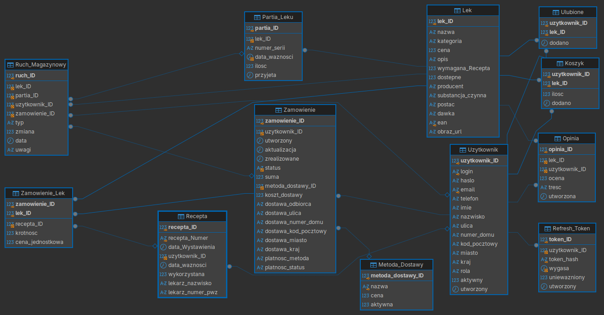
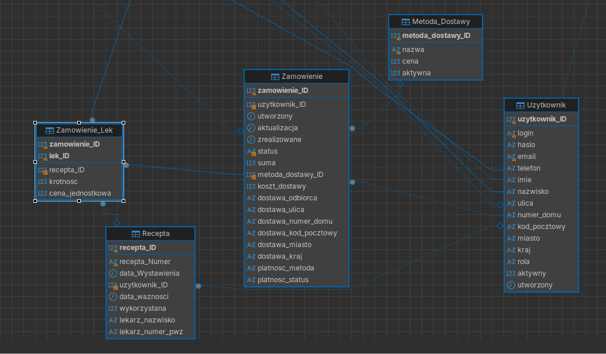
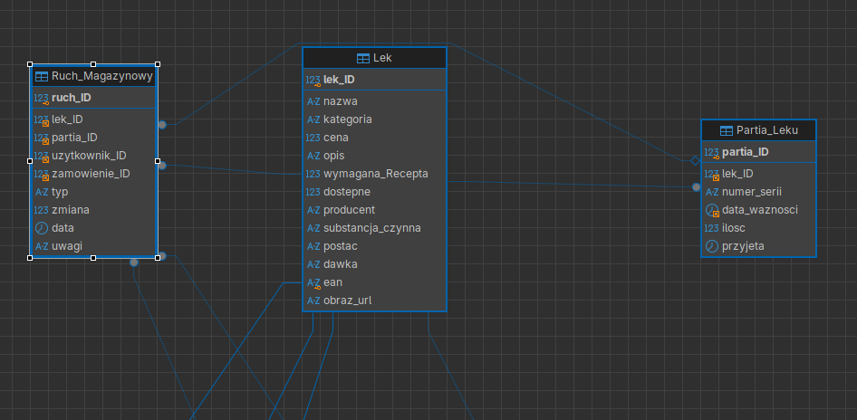
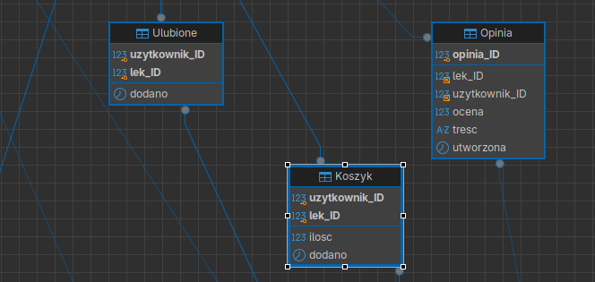

# RAPORT: PROJEKT RELACYJNEJ BAZY DANYCH DLA SYSTEMU APTEKI

**Skład zespołu projektowego:**
* Karol Walczyszyn (Kierownik projektu / Architekt bazy danych)
* Kacper Uchyła (Programista SQL)
* Łukasz Ziembiński (Backend Developer)
* Aleksandra Sandomierska (Frontend Developer)

**Temat projektu:** System Obsługi Apteki (nr. 11)

---

## I. Podsumowanie wykonanych prac związanych z architekturą tabel

W ramach realizacji etapu projektowego i wdrożeniowego przeprowadzono gruntowną ewolucję architektury bazy danych. Wychodząc od bazowego modelu koncepcyjnego (zawierającego pierwotnie 6 podstawowych tabel), strukturę rozbudowano do **12 wyspecjalizowanych encji relacyjnych** zaimplementowanych fizycznie w skrypcie `DBInit.sql`.

Kluczowe zrealizowane prace obejmują:
1. **Unifikację i bezpieczeństwo kont (`Uzytkownik`, `Refresh_Token`):** Połączono tabele personelu i klientów w jeden spójny model użytkowników z kontrolą ról (`KLIENT`, `FARMACEUTA`, `ADMIN`, `PRAKTYKANT`) oraz wydzielono bezpieczną obsługę sesji opartą o skróty tokenów odświeżających (`token_hash`).
2. **Pełną ewidencję partii i gospodarki magazynowej (`Partia_Leku`, `Ruch_Magazynowy`):** Rozwiązano problem śledzenia terminów ważności leków oraz numerów serii (`numer_serii`). Każda zmiana stanu magazynowego jest audytowana z podaniem typu operacji (`DOSTAWA`, `SPRZEDAZ`, `ZWROT`, `KOREKTA`, `UTYLIZACJA`).
3. **Kompleksową obsługę zamówień i logistyki (`Zamowienie`, `Zamowienie_Lek`, `Metoda_Dostawy`):** Wdrożono mechanizm snapshotu cenowego (`cena_jednostkowa` w pozycjach zamówienia chroni historię transakcji przed zmianami w cenniku), powiązanie pozycji z numerem recepty oraz obsługę adresów doręczenia i stawek wysyłki.
4. **Moduły interakcji i koszyka zakupowego (`Koszyk`, `Ulubione`, `Opinia`):** Utworzono trwałe struktury asocjacyjne przechowujące stan koszyka klienta, listę obserwowanych leków oraz recenzje z walidacją ocen w skali 1–5 i blokadą duplikatów opinii dla tego samego preparatu.
5. **Więzy spójności i integralności:** Zaimplementowano reguły kaskadowości (`ON DELETE CASCADE`, `ON DELETE SET NULL`), indeksy przyspieszające wyszukiwanie oraz ograniczenia dziedzinowe `CHECK` zabezpieczające bazę przed wprowadzaniem ujemnych kwot, stanów magazynowych czy nieprawidłowych statusów.

---

## II. Opis zadania i reguł biznesowych

Baza danych została zaprojektowana w celu kompleksowego wsparcia procesów aptecznych: sprzedaży stacjonarnej i wysyłkowej leków (zarówno OTC, jak i na receptę), weryfikacji uprawnień lekarskich, śledzenia partii produkcyjnych oraz monitorowania stanów magazynowych.

### 1. Kto jest kim? (Użytkownicy i Uprawnienia)
* Każda osoba korzystająca z systemu posiada unikalne konto w tabeli `Uzytkownik`, identyfikowane adresem `email` oraz unikalnym `login`.
* Dostęp autoryzowany jest hasłem (przechowywanym w postaci haszowanej) oraz polem `rola`, które warunkuje uprawnienia w systemie (dostęp do modułów magazynowych, realizacji recept lub panelu klienta).
* Uwierzytelnienie sesyjne wspiera tabela `Refresh_Token`, powiązana relacją 1:N z użytkownikiem, z automatycznym unieważnianiem tokenów po upływie terminu `wygasa`.

### 2. Katalog i Magazyn (Lek, Partia_Leku, Ruch_Magazynowy)
* Tabela `Lek` ewidencjonuje preparaty farmaceutyczne wraz z parametrami medycznymi (postać, dawka, substancja czynna, kod EAN) oraz flagą `wymagana_Recepta`.
* Każdy lek w magazynie fizycznym dzielony jest na konkretne dostawy w tabeli `Partia_Leku` – każda seria posiada własny `numer_serii` oraz `data_waznosci`.
* Każde zdarzenie magazynowe (przyjęcie dostawy, sprzedaż, utylizacja przeterminowanych leków) rejestrowane jest w tabeli `Ruch_Magazynowy`, co gwarantuje pełną rozliczalność i historię stanów.

### 3. Moduł Recept (Recepta)
* Leki wymagające przepisu lekarza mogą zostać wydane wyłącznie po wskazaniu rekordu z tabeli `Recepta`.
* Recepta rejestruje unikalny numer identyfikacyjny, datę wystawienia, datę ważności, dane lekarza (w tym numer PWZ) oraz status `wykorzystana`.

### 4. Zakupy i Logistyka (Koszyk, Zamowienie, Zamowienie_Lek, Metoda_Dostawy)
* Klient kompletuje zamówienie w tabeli `Koszyk` (relacja N:M pomiędzy użytkownikiem a lekiem z określeniem ilości).
* Złożenie zamówienia tworzy nagłówek w `Zamowienie` ze statusem realizacji, płatności, adresem doręczenia oraz powiązaniem z wybraną encją `Metoda_Dostawy`.
* Pozycje transakcji trafiają do tabeli `Zamowienie_Lek`, gdzie utrwalana jest historyczna `cena_jednostkowa`, zamawiana krotność oraz ewentualne przypisanie do konkretnej `Recepta`.

### 5. Społeczność i Interakcje (Opinia, Ulubione)
* Klienci mogą dodawać preparaty do listy obserwowanych (`Ulubione`).
* Zaimplementowano moduł recenzji (`Opinia`), w którym użytkownik może wystawić ocenę punktową (1 do 5) wraz z komentarzem tekstowym. Ograniczenie unikalności zapobiega wielokrotnemu ocenianiu tego samego leku przez jedną osobę.

---

## III. Diagram Związków Encji (ERD)

### Pełny schemat bazy danych

### Wybrane fragmenty i podsystemy diagramu ERD

#### 1. Podsystem Zamówień i Recept

#### 2. Podsystem Gospodarki Magazynowej

#### 3. Podsystem Obsługi Klienta i Interakcji

---

## IV. Słownik Danych ERD

### 1. Tabela: `Metoda_Dostawy`
**Rola w systemie:** Tabela słownikowa definiująca dostępne formy dostawy towaru (np. kurier, odbiór osobisty w aptece, paczkomat) wraz z ich aktualnym kosztem i statusem dostępności.

| Element danych (Kolumna) | Typ danych      | Warunki i ograniczenia                        | Opis                                                            |
| :----------------------- | :-------------- | :-------------------------------------------- | :-------------------------------------------------------------- |
| **`metoda_dostawy_ID`**  | `INT`           | OBOWIĄZKOWY, Klucz główny (`AUTO_INCREMENT`)  | Identyfikator sposobu dostawy.                                  |
| **`nazwa`**              | `VARCHAR(64)`   | OBOWIĄZKOWY, Unikalny (`UNIQUE`)              | Unikalna nazwa formy dostawy.                                   |
| **`cena`**               | `DECIMAL(10,2)` | OBOWIĄZKOWY, `DEFAULT 0`, `CHECK (cena >= 0)` | Koszt doręczenia przesyłki.                                     |
| **`aktywna`**            | `TINYINT`       | OBOWIĄZKOWY, `DEFAULT 1`                      | Flaga logiczna dostępności metody (1 = aktywna, 0 = wyłączona). |

---

### 2. Tabela: `Uzytkownik`
**Rola w systemie:** Centralna encja przechowująca dane uwierzytelniające, dane teleadresowe oraz role systemowe wszystkich osób korzystających z apteki (klientów, farmaceutów, administratorów, praktykantów).

| Element danych (Kolumna) | Typ danych     | Warunki i ograniczenia                                                                             | Opis                                                    |
| :----------------------- | :------------- | :------------------------------------------------------------------------------------------------- | :------------------------------------------------------ |
| **`uzytkownik_ID`**      | `INT`          | OBOWIĄZKOWY, Klucz główny (`AUTO_INCREMENT`)                                                       | Identyfikator użytkownika w systemie.                   |
| **`login`**              | `VARCHAR(32)`  | OBOWIĄZKOWY, Unikalny (`UNIQUE`)                                                                   | Unikalna nazwa logowania użytkownika.                   |
| **`haslo`**              | `VARCHAR(255)` | OBOWIĄZKOWY                                                                                        | Skrót hasła dostępowego (hasz).                         |
| **`email`**              | `VARCHAR(128)` | OPCJONALNY, Unikalny (`UNIQUE`)                                                                    | Unikalny adres poczty elektronicznej.                   |
| **`telefon`**            | `VARCHAR(20)`  | OPCJONALNY                                                                                         | Numer telefonu kontaktowego.                            |
| **`imie`**               | `VARCHAR(32)`  | OPCJONALNY                                                                                         | Imię użytkownika.                                       |
| **`nazwisko`**           | `VARCHAR(64)`  | OPCJONALNY                                                                                         | Nazwisko użytkownika.                                   |
| **`ulica`**              | `VARCHAR(255)` | OPCJONALNY                                                                                         | Ulica zamieszkania/siedziby.                            |
| **`numer_domu`**         | `VARCHAR(30)`  | OPCJONALNY                                                                                         | Numer budynku i lokalu.                                 |
| **`kod_pocztowy`**       | `VARCHAR(20)`  | OPCJONALNY                                                                                         | Kod pocztowy.                                           |
| **`miasto`**             | `VARCHAR(64)`  | OPCJONALNY                                                                                         | Miasto zamieszkania.                                    |
| **`kraj`**               | `VARCHAR(64)`  | OPCJONALNY, `DEFAULT 'Polska'`                                                                     | Kraj zamieszkania.                                      |
| **`rola`**               | `VARCHAR(16)`  | OBOWIĄZKOWY, `DEFAULT 'KLIENT'`, `CHECK (rola IN ('KLIENT', 'ADMIN', 'FARMACEUTA', 'PRAKTYKANT'))` | Rola warunkująca poziom uprawnień w systemie.           |
| **`aktywny`**            | `TINYINT`      | OBOWIĄZKOWY, `DEFAULT 1`                                                                           | Status aktywności konta (1 = aktywne, 0 = zablokowane). |
| **`utworzony`**          | `DATETIME`     | OBOWIĄZKOWY, `DEFAULT CURRENT_TIMESTAMP`                                                           | Data i czas rejestracji profilu w systemie.             |

---

### 3. Tabela: `Lek`
**Rola w systemie:** Główny katalog produktów farmaceutycznych oferowanych przez aptekę. Przechowuje dane medyczne leku, cenę bazową, stan magazynowy oraz wymóg posiadania recepty.

| Element danych (Kolumna) | Typ danych      | Warunki i ograniczenia                            | Opis                                                |
| :----------------------- | :-------------- | :------------------------------------------------ | :-------------------------------------------------- |
| **`lek_ID`**             | `INT`           | OBOWIĄZKOWY, Klucz główny (`AUTO_INCREMENT`)      | Identyfikator preparatu leczniczego.                |
| **`nazwa`**              | `VARCHAR(128)`  | OBOWIĄZKOWY                                       | Handlowa nazwa leku.                                |
| **`kategoria`**          | `VARCHAR(64)`   | OPCJONALNY                                        | Grupa terapeutyczna lub kategoria produktu.         |
| **`cena`**               | `DECIMAL(10,2)` | OBOWIĄZKOWY, `CHECK (cena >= 0)`                  | Bieżąca cena katalogowa brutto.                     |
| **`opis`**               | `TEXT`          | OBOWIĄZKOWY                                       | Szczegółowy opis działania, dawkowania i wskazań.   |
| **`wymagana_Recepta`**   | `TINYINT`       | OBOWIĄZKOWY, `DEFAULT 0`                          | Wymóg recepty (1 = lek na receptę Rx, 0 = lek OTC). |
| **`dostepne`**           | `INT`           | OBOWIĄZKOWY, `DEFAULT 0`, `CHECK (dostepne >= 0)` | Łączny bieżący stan magazynowy w opakowaniach.      |
| **`producent`**          | `VARCHAR(64)`   | OPCJONALNY                                        | Podmiot odpowiedzialny / producent.                 |
| **`substancja_czynna`**  | `VARCHAR(128)`  | OPCJONALNY                                        | Międzynarodowa nazwa substancji aktywnej.           |
| **`postac`**             | `VARCHAR(32)`   | OPCJONALNY                                        | Forma leku (np. tabletki, syrop, maść).             |
| **`dawka`**              | `VARCHAR(32)`   | OPCJONALNY                                        | Dawka substancji czynnej (np. 500 mg, 10 ml).       |
| **`ean`**                | `VARCHAR(13)`   | OPCJONALNY, Unikalny (`UNIQUE`)                   | Unikalny kod kreskowy produktu (EAN-13).            |
| **`obraz_url`**          | `VARCHAR(255)`  | OPCJONALNY                                        | Ścieżka lub adres URL do zdjęcia opakowania leku.   |

---

### 4. Tabela: `Recepta`
**Rola w systemie:** Ewidencja recept lekarskich powiązanych z klientami. Umożliwia weryfikację uprawnień do zakupu leków Rx, śledzenie terminu ważności oraz numeru PWZ lekarza.

| Element danych (Kolumna) | Typ danych     | Warunki i ograniczenia                                                       | Opis                                                      |
| :----------------------- | :------------- | :--------------------------------------------------------------------------- | :-------------------------------------------------------- |
| **`recepta_ID`**         | `INT`          | OBOWIĄZKOWY, Klucz główny (`AUTO_INCREMENT`)                                 | Wewnętrzny identyfikator recepty.                         |
| **`recepta_Numer`**      | `VARCHAR(64)`  | OBOWIĄZKOWY, Unikalny (`UNIQUE`)                                             | Unikalny kod/numer e-recepty lub recepty papierowej.      |
| **`data_Wystawienia`**   | `DATE`         | OBOWIĄZKOWY                                                                  | Data wystawienia recepty przez lekarza.                   |
| **`uzytkownik_ID`**      | `INT`          | OPCJONALNY, Klucz obcy (`-> Uzytkownik.uzytkownik_ID`, `ON DELETE SET NULL`) | Pacjent / właściciel recepty.                             |
| **`data_waznosci`**      | `DATE`         | OBOWIĄZKOWY                                                                  | Termin upływu ważności recepty.                           |
| **`wykorzystana`**       | `TINYINT`      | OBOWIĄZKOWY, `DEFAULT 0`                                                     | Flaga realizacji recepty (1 = zrealizowana, 0 = aktywna). |
| **`lekarz_nazwisko`**    | `VARCHAR(128)` | OPCJONALNY                                                                   | Imię i nazwisko lekarza wystawiającego.                   |
| **`lekarz_numer_pwz`**   | `VARCHAR(16)`  | OPCJONALNY                                                                   | Prawo Wykonywania Zawodu lekarza.                         |

---

### 5. Tabela: `Zamowienie`
**Rola w systemie:** Nagłówek transakcji zakupu. Rejestruje klienta składającego zamówienie, statusy logistyczne i finansowe, kwotę łączną, metodę dostawy oraz dane adresowe doręczenia.

| Element danych (Kolumna)   | Typ danych      | Warunki i ograniczenia                                                                                                          | Opis                                                 |
| :------------------------- | :-------------- | :------------------------------------------------------------------------------------------------------------------------------ | :--------------------------------------------------- |
| **`zamowienie_ID`**        | `INT`           | OBOWIĄZKOWY, Klucz główny (`AUTO_INCREMENT`)                                                                                    | Unikalny numer zamówienia.                           |
| **`uzytkownik_ID`**        | `INT`           | OBOWIĄZKOWY, Klucz obcy (`-> Uzytkownik.uzytkownik_ID`)                                                                         | Zamawiający klient.                                  |
| **`utworzony`**            | `DATETIME`      | OBOWIĄZKOWY, `DEFAULT CURRENT_TIMESTAMP`                                                                                        | Data i czas złożenia zamówienia.                     |
| **`aktualizacja`**         | `DATETIME`      | OBOWIĄZKOWY, `DEFAULT CURRENT_TIMESTAMP ON UPDATE CURRENT_TIMESTAMP`                                                            | Czas ostatniej modyfikacji statusu zamówienia.       |
| **`zrealizowane`**         | `DATETIME`      | OPCJONALNY                                                                                                                      | Data sfinalizowania i wydania zamówienia.            |
| **`status`**               | `VARCHAR(20)`   | OBOWIĄZKOWY, `DEFAULT 'NOWE'`, `CHECK (status IN ('NOWE', 'OPLACONE', 'W_REALIZACJI', 'WYSLANE', 'ZREALIZOWANE', 'ANULOWANE'))` | Cykl życia zamówienia w aptece.                      |
| **`suma`**                 | `DECIMAL(10,2)` | OBOWIĄZKOWY, `DEFAULT 0`, `CHECK (suma >= 0)`                                                                                   | Całkowity koszt zamówienia z uwzględnieniem dostawy. |
| **`metoda_dostawy_ID`**    | `INT`           | OPCJONALNY, Klucz obcy (`-> Metoda_Dostawy.metoda_dostawy_ID`, `ON DELETE SET NULL`)                                            | Wybrany wariant transportu lub odbioru.              |
| **`koszt_dostawy`**        | `DECIMAL(10,2)` | OBOWIĄZKOWY, `DEFAULT 0`                                                                                                        | Kwota naliczona za przesyłkę w momencie zakupu.      |
| **`dostawa_odbiorca`**     | `VARCHAR(128)`  | OPCJONALNY                                                                                                                      | Imię i nazwisko osoby odbierającej paczkę.           |
| **`dostawa_ulica`**        | `VARCHAR(255)`  | OPCJONALNY                                                                                                                      | Ulica docelowa wysyłki zamówienia.                   |
| **`dostawa_numer_domu`**   | `VARCHAR(30)`   | OPCJONALNY                                                                                                                      | Numer posesji / lokalu dla doręczenia.               |
| **`dostawa_kod_pocztowy`** | `VARCHAR(20)`   | OPCJONALNY                                                                                                                      | Kod pocztowy doręczenia.                             |
| **`dostawa_miasto`**       | `VARCHAR(64)`   | OPCJONALNY                                                                                                                      | Miasto doręczenia przesyłki.                         |
| **`dostawa_kraj`**         | `VARCHAR(64)`   | OPCJONALNY                                                                                                                      | Kraj doręczenia przesyłki.                           |
| **`platnosc_metoda`**      | `VARCHAR(64)`   | OPCJONALNY                                                                                                                      | Nazwa formy zapłaty (np. BLIK, Karta, Przelew).      |
| **`platnosc_status`**      | `VARCHAR(20)`   | OBOWIĄZKOWY, `DEFAULT 'OCZEKUJACA'`, `CHECK (platnosc_status IN ('OCZEKUJACA', 'OPLACONA', 'NIEUDANA', 'ZWROCONA'))`            | Aktualny stan rozliczenia transakcji.                |

---

### 6. Tabela: `Zamowienie_Lek`
**Rola w systemie:** Tabela asocjacyjna realizująca relację wiele-do-wielu ($N:M$) między zamówieniem a lekami. Utrwala historyczną cenę zakupu (snapshot cenowy), liczbę sztuk oraz powiązanie z e-receptą.

| Element danych (Kolumna) | Typ danych      | Warunki i ograniczenia                                                                                 | Opis                                               |
| :----------------------- | :-------------- | :----------------------------------------------------------------------------------------------------- | :------------------------------------------------- |
| **`zamowienie_ID`**      | `INT`           | OBOWIĄZKOWY, Współtworzy Klucz Główny, Klucz obcy (`-> Zamowienie.zamowienie_ID`, `ON DELETE CASCADE`) | Identyfikator zamówienia nadrzędnego.              |
| **`lek_ID`**             | `INT`           | OBOWIĄZKOWY, Współtworzy Klucz Główny, Klucz obcy (`-> Lek.lek_ID`)                                    | Identyfikator zamawianego preparatu.               |
| **`recepta_ID`**         | `INT`           | OPCJONALNY, Klucz obcy (`-> Recepta.recepta_ID`)                                                       | Przypisana recepta (wymagana przy lekach Rx).      |
| **`krotnosc`**           | `INT`           | OBOWIĄZKOWY, `DEFAULT 1`, `CHECK (krotnosc > 0)`                                                       | Liczba zamówionych opakowań leku.                  |
| **`cena_jednostkowa`**   | `DECIMAL(10,2)` | OBOWIĄZKOWY, `CHECK (cena_jednostkowa >= 0)`                                                           | Utrwalona historyczna cena leku w momencie zakupu. |

---

### 7. Tabela: `Koszyk`
**Rola w systemie:** Trwałe przechowywanie zawartości koszyka zakupowego klienta przed sfinalizowaniem zamówienia, wspierające sesje wielourządzeniowe.

| Element danych (Kolumna) | Typ danych | Warunki i ograniczenia                                                                                 | Opis                                         |
| :----------------------- | :--------- | :----------------------------------------------------------------------------------------------------- | :------------------------------------------- |
| **`uzytkownik_ID`**      | `INT`      | OBOWIĄZKOWY, Współtworzy Klucz Główny, Klucz obcy (`-> Uzytkownik.uzytkownik_ID`, `ON DELETE CASCADE`) | Właściciel wirtualnego koszyka.              |
| **`lek_ID`**             | `INT`      | OBOWIĄZKOWY, Współtworzy Klucz Główny, Klucz obcy (`-> Lek.lek_ID`, `ON DELETE CASCADE`)               | Wybrany preparat leczniczy.                  |
| **`ilosc`**              | `INT`      | OBOWIĄZKOWY, `DEFAULT 1`, `CHECK (ilosc > 0)`                                                          | Pożądana liczba sztuk preparatu.             |
| **`dodano`**             | `DATETIME` | OBOWIĄZKOWY, `DEFAULT CURRENT_TIMESTAMP`                                                               | Data i czas umieszczenia produktu w koszyku. |

---

### 8. Tabela: `Refresh_Token`
**Rola w systemie:** Bezpieczna obsługa autoryzacji sesji użytkowników w architekturze JWT (JSON Web Token) z funkcją unieważniania tokenów po wylogowaniu lub upływie ważności.

| Element danych (Kolumna) | Typ danych | Warunki i ograniczenia                                                       | Opis                                                      |
| :----------------------- | :--------- | :--------------------------------------------------------------------------- | :-------------------------------------------------------- |
| **`token_ID`**           | `INT`      | OBOWIĄZKOWY, Klucz główny (`AUTO_INCREMENT`)                                 | Identyfikator tokenu sesyjnego.                           |
| **`uzytkownik_ID`**      | `INT`      | OBOWIĄZKOWY, Klucz obcy (`-> Uzytkownik.uzytkownik_ID`, `ON DELETE CASCADE`) | Użytkownik, do którego należy sesja.                      |
| **`token_hash`**         | `CHAR(64)` | OBOWIĄZKOWY, Unikalny (`UNIQUE`)                                             | Kryptograficzny skrót (SHA-256) tokenu odświeżającego.    |
| **`wygasa`**             | `DATETIME` | OBOWIĄZKOWY                                                                  | Termin wygaśnięcia ważności tokenu.                       |
| **`uniewazniony`**       | `TINYINT`  | OBOWIĄZKOWY, `DEFAULT 0`                                                     | Flaga unieważnienia tokenu (1 = unieważniony, 0 = ważny). |
| **`utworzony`**          | `DATETIME` | OBOWIĄZKOWY, `DEFAULT CURRENT_TIMESTAMP`                                     | Moment wygenerowania sesji.                               |

---

### 9. Tabela: `Partia_Leku`
**Rola w systemie:** Ewidencja partii produkcyjnych i dostaw magazynowych. Zapewnia kontrolę nad numerami serii (`LOT`) oraz datami przydatności do spożycia każdego leku w magazynie apteki.

| Element danych (Kolumna) | Typ danych    | Warunki i ograniczenia                                           | Opis                                            |
| :----------------------- | :------------ | :--------------------------------------------------------------- | :---------------------------------------------- |
| **`partia_ID`**          | `INT`         | OBOWIĄZKOWY, Klucz główny (`AUTO_INCREMENT`)                     | Unikalny identyfikator danej partii towarowej.  |
| **`lek_ID`**             | `INT`         | OBOWIĄZKOWY, Klucz obcy (`-> Lek.lek_ID`, `ON DELETE CASCADE`)   | Preparat leczniczy, którego dotyczy partia.     |
| **`numer_serii`**        | `VARCHAR(64)` | OBOWIĄZKOWY, Unikalny w parze z `lek_ID` (`uq_partia_lek_seria`) | Oznaczenie partii nadane przez producenta.      |
| **`data_waznosci`**      | `DATE`        | OBOWIĄZKOWY                                                      | Data minimalnej trwałości partii medykamentu.   |
| **`ilosc`**              | `INT`         | OBOWIĄZKOWY, `DEFAULT 0`, `CHECK (ilosc >= 0)`                   | Liczba dostępnych opakowań z danej serii.       |
| **`przyjeta`**           | `DATETIME`    | OBOWIĄZKOWY, `DEFAULT CURRENT_TIMESTAMP`                         | Data i czas wprowadzenia partii na stan apteki. |

---

### 10. Tabela: `Ruch_Magazynowy`
**Rola w systemie:** Dziennik zdarzeń magazynowych (audyt log). Rejestruje każdą operację zmieniającą stan asortymentu (dostawa od hurtowni, sprzedaż, zwrot, korekta inwentaryzacyjna, utylizacja).

| Element danych (Kolumna) | Typ danych     | Warunki i ograniczenia                                                                  | Opis                                                   |
| :----------------------- | :------------- | :-------------------------------------------------------------------------------------- | :----------------------------------------------------- |
| **`ruch_ID`**            | `INT`          | OBOWIĄZKOWY, Klucz główny (`AUTO_INCREMENT`)                                            | Identyfikator operacji magazynowej.                    |
| **`lek_ID`**             | `INT`          | OBOWIĄZKOWY, Klucz obcy (`-> Lek.lek_ID`, `ON DELETE CASCADE`)                          | Lek podlegający operacji magazynowej.                  |
| **`partia_ID`**          | `INT`          | OPCJONALNY, Klucz obcy (`-> Partia_Leku.partia_ID`, `ON DELETE SET NULL`)               | Konkretna partia, z której pobrano lub przyjęto towar. |
| **`uzytkownik_ID`**      | `INT`          | OPCJONALNY, Klucz obcy (`-> Uzytkownik.uzytkownik_ID`, `ON DELETE SET NULL`)            | Pracownik apteki wykonujący operację magazynową.       |
| **`zamowienie_ID`**      | `INT`          | OPCJONALNY, Klucz obcy (`-> Zamowienie.zamowienie_ID`, `ON DELETE SET NULL`)            | Powiązane zamówienie klienta (dla operacji sprzedaży). |
| **`typ`**                | `VARCHAR(20)`  | OBOWIĄZKOWY, `CHECK (typ IN ('DOSTAWA', 'SPRZEDAZ', 'ZWROT', 'KOREKTA', 'UTYLIZACJA'))` | Rodzaj przepływu towarowego.                           |
| **`zmiana`**             | `INT`          | OBOWIĄZKOWY, `CHECK (zmiana <> 0)`                                                      | Wartość zmiany stanu (dodatnia lub ujemna).            |
| **`data`**               | `DATETIME`     | OBOWIĄZKOWY, `DEFAULT CURRENT_TIMESTAMP`                                                | Moment zarejestrowania przesunięcia magazynowego.      |
| **`uwagi`**              | `VARCHAR(255)` | OPCJONALNY                                                                              | Dodatkowy komentarz lub powód korekty/utylizacji.      |

---

### 11. Tabela: `Opinia`
**Rola w systemie:** Umożliwia klientom wystawianie recenzji zakupionym lekom (ocena w skali 1–5 oraz komentarz tekstowy), uniemożliwiając wielokrotne ocenianie tego samego leku przez jedną osobę.

| Element danych (Kolumna) | Typ danych | Warunki i ograniczenia                                                       | Opis                                                                 |
| :----------------------- | :--------- | :--------------------------------------------------------------------------- | :------------------------------------------------------------------- |
| **`opinia_ID`**          | `INT`      | OBOWIĄZKOWY, Klucz główny (`AUTO_INCREMENT`)                                 | Identyfikator recenzji.                                              |
| **`lek_ID`**             | `INT`      | OBOWIĄZKOWY, Klucz obcy (`-> Lek.lek_ID`, `ON DELETE CASCADE`)               | Oceniany preparat leczniczy.                                         |
| **`uzytkownik_ID`**      | `INT`      | OBOWIĄZKOWY, Klucz obcy (`-> Uzytkownik.uzytkownik_ID`, `ON DELETE CASCADE`) | Autor wystawiający ocenę.                                            |
| **`ocena`**              | `TINYINT`  | OBOWIĄZKOWY, `CHECK (ocena BETWEEN 1 AND 5)`                                 | Wartość punktowa w skali 1 do 5.                                     |
| **`tresc`**              | `TEXT`     | OPCJONALNY                                                                   | Tekstowa treść recenzji produktu.                                    |
| **`utworzona`**          | `DATETIME` | OBOWIĄZKOWY, `DEFAULT CURRENT_TIMESTAMP`                                     | Data i czas opublikowania opinii.                                    |
| *Ograniczenie złożone*   | –          | `UNIQUE (uzytkownik_ID, lek_ID)`                                             | Blokada duplikatów: jeden użytkownik może ocenić dany lek tylko raz. |

---

### 12. Tabela: `Ulubione`
**Rola w systemie:** Przechowuje listę preparatów oznaczonych przez klienta jako obserwowane/ulubione, ułatwiając szybki dostęp do powtarzalnych zakupów.

| Element danych (Kolumna) | Typ danych | Warunki i ograniczenia                                                                                 | Opis                                |
| :----------------------- | :--------- | :----------------------------------------------------------------------------------------------------- | :---------------------------------- |
| **`uzytkownik_ID`**      | `INT`      | OBOWIĄZKOWY, Współtworzy Klucz Główny, Klucz obcy (`-> Uzytkownik.uzytkownik_ID`, `ON DELETE CASCADE`) | Użytkownik obserwujący produkt.     |
| **`lek_ID`**             | `INT`      | OBOWIĄZKOWY, Współtworzy Klucz Główny, Klucz obcy (`-> Lek.lek_ID`, `ON DELETE CASCADE`)               | Obserwowany lek.                    |
| **`dodano`**             | `DATETIME` | OBOWIĄZKOWY, `DEFAULT CURRENT_TIMESTAMP`                                                               | Data dodania leku do obserwowanych. |

---

## V. Relacje między encjami

W architekturze bazy danych zastosowano spójny zestaw powiązań relacyjnych gwarantujący integralność referencyjną:

1. **`Uzytkownik` – `Zamowienie` (Relacja $1:N$):**
   * Jeden użytkownik może złożyć wiele zamówień ($0..N$). Każde zamówienie musi być przypisane do dokładnie jednego użytkownika ($1:1$).
   * Klucz obcy: `Zamowienie.uzytkownik_ID` odwołuje się do `Uzytkownik.uzytkownik_ID`.
2. **`Zamowienie` – `Metoda_Dostawy` (Relacja $N:1$):**
   * Wiele zamówień może korzystać z tej samej metody wysyłki ($N:1$).
   * Klucz obcy: `Zamowienie.metoda_dostawy_ID` odwołuje się do `Metoda_Dostawy.metoda_dostawy_ID`. Usunięcie metody nie niszczy historii zamówień dzięki regule `ON DELETE SET NULL`.
3. **`Zamowienie` – `Lek` (Relacja $N:M$ poprzez `Zamowienie_Lek`):**
   * Zamówienie może obejmować wiele leków, a dany lek może występować w wielu zamówieniach.
   * Tabela łącząca `Zamowienie_Lek` ma klucz złożony `(zamowienie_ID, lek_ID)` oraz kaskadowe usuwanie (`ON DELETE CASCADE`) powiązane z nagłówkiem zamówienia.
4. **`Zamowienie_Lek` – `Recepta` (Relacja $N:1$ opcjonalna):**
   * Pozycja zamówienia wymagająca recepty wskazuje na klucz obcy `Zamowienie_Lek.recepta_ID`. Dla leków bez recepty pole przyjmuje wartość `NULL`.
5. **`Uzytkownik` – `Recepta` (Relacja $1:N$ opcjonalna):**
   * Recepta może być przypisana do konta pacjenta (`Recepta.uzytkownik_ID`), ale system dopuszcza e-recepty niezarejestrowanych jeszcze osób (`ON DELETE SET NULL`).
6. **`Uzytkownik` – `Lek` (Relacje $N:M$ poprzez `Koszyk`, `Ulubione`, `Opinia`):**
   * `Koszyk`: Przechowuje bieżące pozycje klienta; usunięcie konta lub leku kaskadowo czyści zawartość koszyka (`ON DELETE CASCADE`).
   * `Ulubione`: Relacja asocjacyjna list życzeń (`ON DELETE CASCADE`).
   * `Opinia`: Relacja $N:M$ z dodatkowym ograniczeniem `UNIQUE (uzytkownik_ID, lek_ID)`, co wymusza, że użytkownik może wystawić dla danego leku co najwyżej jedną opinię.
7. **`Uzytkownik` – `Refresh_Token` (Relacja $1:N$):**
   * Jeden użytkownik może posiadać aktywne sesje na wielu urządzeniach ($1:N$). Usunięcie konta kaskadowo unieważnia wszystkie tokeny (`ON DELETE CASCADE`).
8. **`Lek` – `Partia_Leku` (Relacja $1:N$):**
   * Jeden lek w katalogu może posiadać wiele fizycznych partii dostawczych z różnymi datami ważności i numerami serii ($1:N$).
9. **`Ruch_Magazynowy` – Powiązania Audytowe ($N:1$):**
   * Każdy wpis w dzienniku ruchów odnosi się obowiązkowo do leku (`Lek.lek_ID`), a opcjonalnie do konkretnej partii (`Partia_Leku`), zamówienia (`Zamowienie`) oraz pracownika wykonującego operację (`Uzytkownik`).

---

## VI. Normalizacja Bazy Danych

Projekt bazy danych spełnia rygorystyczne wymagania trzeciej postaci normalnej (3NF):

1. **Pierwsza Postać Normalna (1NF):** Wszystkie wartości kolumn we wszystkich 12 tabelach są atomowe (niepodzielne). Dane adresowe użytkowników oraz odbiorców dostawy rozbito na odrębne atrybuty (`ulica`, `numer_domu`, `kod_pocztowy`, `miasto`, `kraj`). W żadnej tabeli nie występują zagnieżdżone kolekcje ani powtarzające się grupy kolumn.
2. **Druga Postać Normalna (2NF):** Baza spełnia warunki 1NF, a wszystkie kolumny niekluczowe wykazują pełną zależność funkcyjną od całego klucza głównego. W tabelach o kluczach kompozytowych (`Zamowienie_Lek`, `Koszyk`, `Ulubione`):
   - W tabeli `Zamowienie_Lek` wartości `krotnosc`, `cena_jednostkowa` oraz opcjonalna `recepta_ID` wynikają bezpośrednio z kombinacji `(zamowienie_ID, lek_ID)` i nie zależą od żadnego pojedynczego atrybutu klucza.
   - W tabeli `Koszyk` atrybuty `ilosc` i `dodano` zależą ściśle od złożonego klucza `(uzytkownik_ID, lek_ID)`.
3. **Trzecia Postać Normalna (3NF):** Wyeliminowano zależności przechodnie między atrybutami niekluczowymi. Wszystkie kolumny zależą bezpośrednio wyłącznie od klucza głównego:
   - Metody dostawy oraz ich koszty wydzielono do tabeli `Metoda_Dostawy`, zapobiegając redundancji stawek w tabeli `Zamowienie`.
   - Dane partii towaru (`numer_serii`, `data_waznosci`) odseparowano od ogólnego katalogu leków (`Lek`), co chroni przed anomaliami w przypadku wielu dostaw tego samego medykamentu.
   - Recepty z danymi wystawiającego lekarza stanowią niezależną encję, z którą pozycje zamówień łączą się wyłącznie przez klucz obcy.